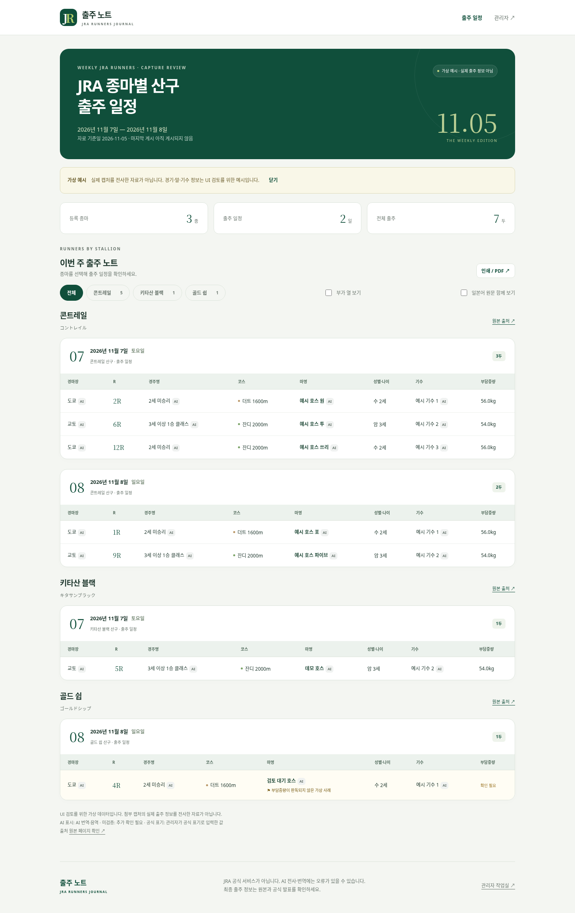

# 출주 노트 · JRA Capture Schedule

관리자가 일본 경마 출주표를 GPT에서 구조화·번역한 뒤 JSON으로 붙여넣고, 원본과 대조하여 한국어 일정을 게시하는 프로토타입입니다. 기존 `JRA_Schedule_for_each_stallion`과 코드·Git 이력·저장소가 독립적입니다.

**현재 상태:** 사용자 제공 새 공개 저장소 [PoongzaGoon/JRA_schedule](https://github.com/PoongzaGoon/JRA_schedule)용으로 구현·검증했습니다. 기존 저장소는 수정하지 않았습니다. Vercel + Turso 배포 구조를 지원합니다. 실제 운영 배포는 아직 수행하지 않았습니다. 저장소 공개 범위는 GitHub Settings에서 이후 변경할 수 있습니다.

[공개 화면 미리보기](docs/review/public-desktop.png) · [모바일 화면](docs/review/public-mobile.png) · [관리자 화면](docs/review/admin-desktop.png)



스크린샷은 브라우저 테스트의 **가상 예시 데이터**입니다. 실행 시에는 빈 공개 화면에서 시작합니다.

## 기능

- `/`: 종마별·날짜별 한국어 출주표, 일본어 원문 토글, 부가 열, 출처, 자료 기준일·게시 시각, 인쇄/PDF.
- `/admin`: 서버 관리자 인증, JSON 붙여넣기/파일 업로드, 오류·경고 및 날짜별 행 수 검증, 미리보기, 확인 후 게시.
- 원본 이미지를 브라우저에서만 열어 표와 나란히 비교. 확대/닫기 지원. **이미지는 서버나 저장소로 전송되지 않습니다.**
- 이전 게시본 검토·복원. 복원도 새 이력으로 기록됩니다. 최근 100개 이력을 표시하며 과거 데이터는 DB에 보존됩니다.
- 게시·복원은 SQLite/libSQL 쓰기 트랜잭션으로 처리. 검증 이후 다른 게시가 있으면 409 충돌로 덮어쓰기를 방지합니다.
- 서버 스키마를 기준으로 JSON Schema와 GPT 추출 프롬프트를 자동 생성. 관리자 화면에서 복사/TXT 저장 가능.
- 로그인 속도 제한, 서버 세션, HttpOnly/SameSite 쿠키, HTTPS Secure 쿠키, origin/CSRF 검증.
- 인증 또는 저장소 설정이 누락되면 관리자 쓰기는 차단되고 설정 필요 상태를 표시합니다.

자동 스크래핑·자동 캡처·GPT API 호출·이미지 영구 보관·다중 관리자 계정은 첫 버전 범위에 없습니다.

## 기술 선택

Node.js **24 LTS**, 기본 HTTP 서버와 `node:sqlite`, Zod 4, 빌드 도구 없는 HTML/CSS/JavaScript입니다. 로컬에서는 SQLite 파일로 외부 계정 없이 검토할 수 있고, 운영에서는 Turso의 관리형 libSQL에 데이터와 인증 상태를 보관합니다. 프론트엔드는 비밀번호나 인증 비밀을 포함하지 않습니다.

운영 대상은 **Vercel 정적 프론트엔드 + Node.js Functions + Turso**입니다. 로컬 컴퓨터를 켜둘 필요가 없습니다. 프론트엔드는 같은 도메인의 `/api/*`를 호출하며, DB 토큰과 비밀번호 해시는 서버에만 둡니다. 함수 인스턴스의 임시 파일에는 운영 데이터를 저장하지 않습니다. 기존 Node HTTP + SQLite 개발/컨테이너 실행도 지원합니다.

## Vercel 배포

1. Turso에서 운영용 데이터베이스와 쓰기 가능한 DB 토큰을 준비합니다.
2. Vercel에 이 GitHub 저장소를 Import합니다. Framework는 Other, Node.js는 24.x이며 빌드/출력/라우팅은 `vercel.json`에 설정되어 있습니다.
3. Vercel 환경변수에 `TURSO_DATABASE_URL`, `TURSO_AUTH_TOKEN`, `ADMIN_PASSWORD_HASH`, `APP_ORIGIN`을 설정합니다. `APP_ORIGIN`은 실제 HTTPS 도메인과 정확히 일치해야 합니다. 해시는 `npm run admin:password`로 생성합니다.
4. 배포 후 `/api/health`에서 모든 항목이 `true`인지 확인하고 관리자 게시·복원을 검증합니다. 테이블은 첫 API 요청에서 자동으로 생성됩니다.

Production과 Preview는 별도 DB/토큰을 사용하세요. 자세한 도메인 설정, 비밀값 입력, 검증 및 백업 절차는 [Vercel 배포 안내](docs/DEPLOYMENT.md)를 참고하세요.

## 로컬 실행

Node 24를 설치한 환경에서:

```sh
npm ci
cp .env.example .env
npm run admin:password
```

명령에 표시되는 입력창에 12자 이상의 비밀번호를 입력합니다. 비밀번호는 화면에 표시되지 않습니다. 출력된 `scrypt:...` 해시를 `.env`의 `ADMIN_PASSWORD_HASH`에 붙여넣습니다. 해시도 Git에 커밋하지 마세요.

```sh
npm run build
npm start
```

- 공개 화면: `http://localhost:3000`
- 관리자 화면: `http://localhost:3000/admin`
- 최초 공개 화면에는 **게시 데이터가 없습니다**. '가상 예시 살펴보기'는 브라우저에서만 예시를 표시하며 게시하지 않습니다.
- 관리자 화면의 '가상 예시 불러오기' → 검증 → 확인 체크 → 게시로 검토할 수 있습니다. 예시 표시가 공개 화면에도 유지됩니다.
- 개발: `npm run dev` (프론트엔드를 수정하면 `npm run build`로 `dist/`를 갱신하거나 `dist/`를 제거해 `public/`를 직접 서빙).

## 환경변수

| 이름 | 용도 |
| --- | --- |
| `ADMIN_PASSWORD_HASH` | `npm run admin:password`로 만든 scrypt 해시. 서버 전용 |
| `TURSO_DATABASE_URL` | 운영 Turso DB URL (`libsql://…` 또는 `https://…`) |
| `TURSO_AUTH_TOKEN` | 운영 DB 쓰기 토큰. Vercel 서버 환경변수로만 설정 |
| `DATABASE_PATH` | 로컬/컨테이너 SQLite 영속 파일. 예: `./data/schedule.sqlite`, 컨테이너 `/data/schedule.sqlite` |
| `APP_ORIGIN` | 사이트의 정확한 origin. 로컬 `http://localhost:3000`, 운영 `https://your-domain.example` |
| `NODE_ENV` | 운영은 `production`. 운영에서는 HTTPS origin을 요구 |
| `HOST` | 기본 `127.0.0.1`. 컨테이너는 `0.0.0.0` |
| `PORT` | 기본 `3000` |

`.env`·DB·실제 캡처·비밀번호는 커밋 대상이 아닙니다. Vercel에서는 외부 Turso DB가 게시 이력을 보존합니다. 로컬/컨테이너는 DB 디렉터리를 영속 볼륨에 연결해야 합니다. 운영에서는 `.env` 대신 호스팅 비밀값 설정을 권장합니다.

## 스키마와 GPT 사용

- [스키마 안내](docs/SCHEMA.md)
- [GPT 추출 프롬프트](docs/GPT-PROMPT.txt)
- [JSON Schema](public/schedule.schema.json)
- [가상 예시 JSON](examples/fictional-schedule.json)

프롬프트와 스키마는 `src/schema.js`에서 생성됩니다. 수정 후 `npm run resources` 또는 `npm run build`를 실행하세요. 관리자 화면의 복사본도 같은 생성 파일을 사용합니다. 첨부 캡처의 실제 내용을 임의 전사한 자료를 예시로 게시하지 않았습니다.

실제 운영 순서: 날짜별 큰 캡처 + 자료 기준일 + 원본 URL을 GPT에 전달 → 생성 JSON 붙여넣기 → 오류 수정 → 원본과 행 수·이름·숫자 대조 → 경고 확인 → 게시. 누락 값은 `null`로 두고 확인 표시를 유지하세요.

## 검사

```sh
npm run build
npm test
# 최초 브라우저 준비 (원하는 개발 환경에서)
npx playwright install chromium
npm run test:e2e
npm run test:e2e:remote # 동일한 브라우저 시나리오를 비동기 libSQL 저장 계층에서 검증
```

설치된 Chromium을 사용하려면 `PLAYWRIGHT_CHROMIUM_EXECUTABLE`을 지정합니다. E2E는 별도 임시 DB·테스트 비밀번호를 사용하고 `127.0.0.1:4217`에 테스트 서버를 실행한 뒤 종료합니다. 실제 데이터는 수정하지 않습니다. 스크린샷은 기본 `work/browser/`에 저장되어 Git에 포함되지 않습니다.

검증 범위: 스키마, 중복, null 경고, 인증/권한/CSRF, 게시 충돌, 트랜잭션 롤백, 복원, 재시작 후 데이터·세션 유지, 로그인 제한, 브라우저 입력 보존·미리보기·게시·복원·모바일 가로 넘침. 프로토타입의 형식 검증은 **이미지 전사의 사실 정확성을 검증하지 않습니다**.

## 배포와 원격 연결

- [배포·백업·검증 절차](docs/DEPLOYMENT.md)
- [GitHub 저장소 연결](docs/GITHUB.md)

라이브 배포는 별도 승인 후 진행합니다. 공개 소스에 운영 비밀값이나 실제 원본 캡처를 올리지 않습니다. 저장소 공개 범위와 사이트 공개 범위는 별개입니다.

## 비용 및 한계

GPT API를 호출하지 않아 이 웹사이트 자체의 GPT API 비용은 없습니다. 외부 GPT 사용 요금은 사용자의 플랜에 따릅니다. 배포 시 서버·영속 디스크·도메인 비용은 선택한 제공자의 요금에 따르며 무료 운영을 보장하지 않습니다.

단일 관리자용입니다. Vercel의 여러 함수 인스턴스는 같은 외부 DB를 공유하며, 로컬 SQLite 운영은 단일 서버 인스턴스를 사용합니다. 다중 사용자·SSO/MFA·비밀번호 복구·이미지 영구 보관·대량 이력 탐색·운영 모니터링은 후속 범위입니다. 캡처·번역·공개 데이터의 이용 가능 범위와 출처 표시는 운영자가 확인해야 합니다. 운영 HTTPS·Turso 연결·백업 복구·실제 사용자 입력은 배포 환경에서 최종 검증해야 합니다.
